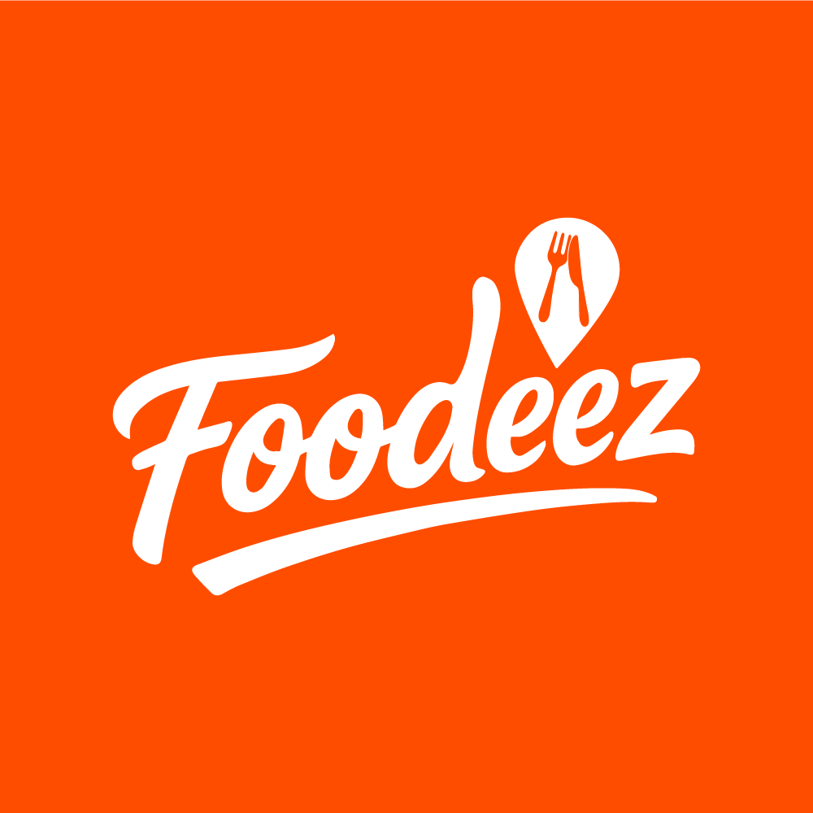

# 🍽️ Foodeez - Modern Food Exploring Platform

Foodeez is a cutting-edge food exploring platform built with Next.js 16, offering a seamless experience for exploring food online. The platform features a modern UI, real-time reviews, and an intuitive user interface.

## ✨ Features

- 🔍 Restaurant search and profiles with Google reviews, hours and photos
- 🛒 Cart and checkout for delivery and pickup: Stripe card payments, plus cash where the restaurant allows it
- 🏷️ Online discounts and coupon codes
- 📦 Order history, live order status and notifications
- 🔐 Accounts with email confirmation, password reset and account deletion
- ⭐ Reviews, food stories and table reservations
- 🏪 Restaurant registration and ownership claims (approved in the admin app)

## 📌 Version

Current release: **v1.0.0** (2026-11-26), the first stable release. For the next few months only minor fixes and tests are planned; larger features wait for v2. Release, deployment and v2 notes are in [AGENTS.md](AGENTS.md).

## 🛠️ Tech Stack

- **Framework:** Next.js 16 (App Router) and React 19
- **Language:** TypeScript
- **Styling:** Tailwind CSS
- **UI Components:** Radix UI
- **Animations:** Framer Motion
- **Maps Integration:** Google Maps API
- **Database:** MySQL through Prisma 7
- **Auth:** NextAuth
- **Payments:** Stripe Checkout
- **Email:** Resend
- **Media:** AWS S3
- **Icons:** Lucide React & React Icons
- **Date Handling:** date-fns
- **Utilities:** clsx, tailwind-merge

## 🚀 Getting Started

### Prerequisites

- Node.js 22 or later
- npm
- Access to a MySQL database (use a separate one for development)

### Installation

1. Clone the repository:
```bash
git clone https://github.com/Future-Rafay/foodeez.ch.git
cd foodeez.ch/frontend
```

2. Install dependencies:
```bash
npm install
```

3. Set up environment variables:
Copy `frontend/.env.example` to `frontend/.env` and fill in the values. It lists every variable the app reads.

4. Run the development server:
```bash
npm run dev
```

Open [http://localhost:3000](http://localhost:3000) with your browser to see the result.

## 📁 Project Structure

```
src/
├── app/          # Next.js app directory
├── components/   # React components
│   ├── core/     # Core components
│   ├── home/     # Home page components
│   ├── layout/   # Layout components
│   └── ui/       # UI components
├── emails/       # React Email templates
├── lib/          # Domain logic and helpers, with *.test.ts beside them
├── services/     # Data access and server actions
├── stores/       # Zustand cart store
├── types/        # TypeScript types
└── proxy.ts      # Sign-in guard for account routes
```

## 🛠️ Available Scripts

- `npm run dev` - Start development server
- `npm run build` - Build for production
- `npm run start` - Start production server
- `npm run lint` - Run ESLint
- `npm test` - Run the regression tests in `src/**/*.test.ts`

Contributor and AI-agent rules live in [AGENTS.md](AGENTS.md).

## 📝 License

This is a private project. All rights reserved.

## 🙏 Built With

- [Next.js](https://nextjs.org)
- [Tailwind CSS](https://tailwindcss.com)
- [Radix UI](https://www.radix-ui.com)
- [Framer Motion](https://www.framer.com/motion/)
- [Prisma](https://www.prisma.io)


